# OldOS for Android (iOS 4 Simulator)

<p align="center">
  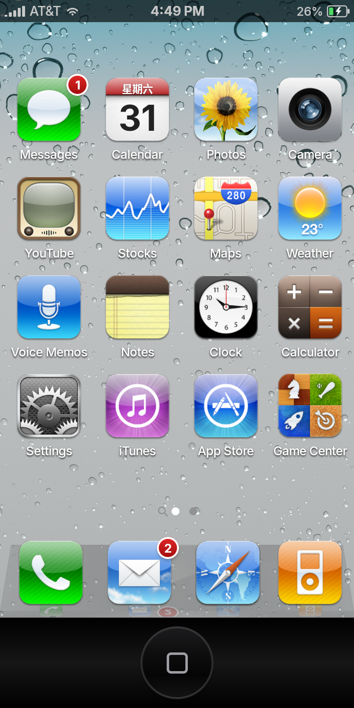
  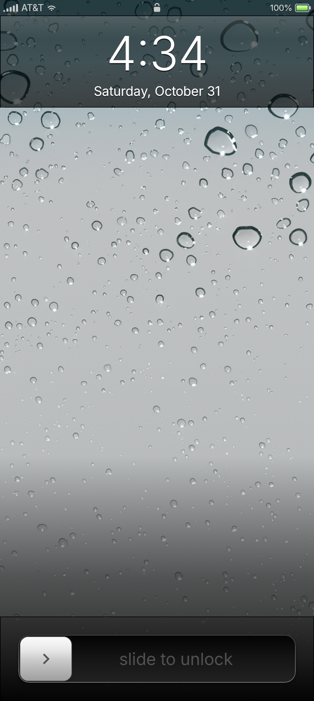
  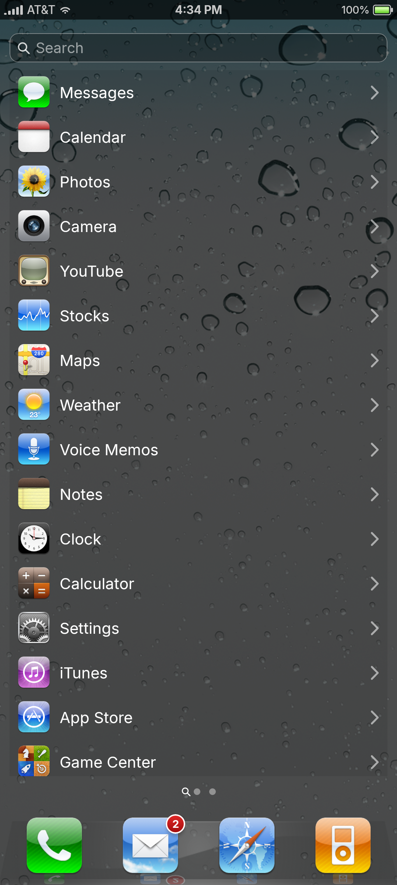
  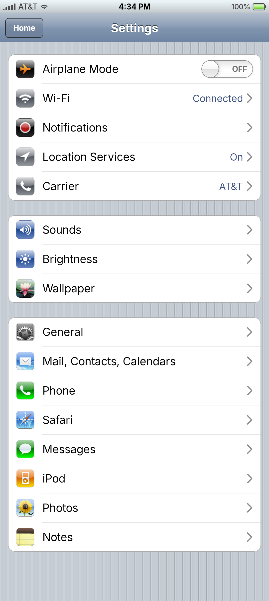
</p>

<p align="center">
  <b>A nostalgic recreation of iOS 4 on modern Android, built with Jetpack Compose.</b><br/>
  Skeuomorphic gradients, linen textures, real SMS, real call log, real photos and music —
  and a virtual home button with multitasking.
</p>

<p align="center">
  <a href="#features">Features</a> •
  <a href="#screenshots">Screenshots</a> •
  <a href="#architecture">Architecture</a> •
  <a href="#getting-started">Getting Started</a> •
  <a href="#permissions">Permissions</a> •
  <a href="#credits">Credits</a>
</p>

---

## ✨ Features

### 1. SpringBoard & System
- **Authentic Grid**: 4-column icon grid (80 pt cells, 60 pt icons) with drop shadows, badges and the mirrored-glass dock.
- **Spotlight Search**: page 0 is a working Spotlight — dark scrim over the wallpaper, live search across all apps.
- **Lock Screen**: big thin clock, shimmering *slide to unlock*, real unlock sound.
- **Multitasking Tray**: double-tap the virtual home button; media controls are wired to the real iPod playback engine.
- **Jiggle Mode**: long-press the wallpaper to edit icons.
- **Folders**: the Utilities folder opens as a dimmed, notched overlay — iOS 4 style.
- **320 pt Design Canvas**: the whole OS renders on a virtual 320 pt-wide canvas scaled to your screen — tall phones simply get a longer home screen.

### 2. Built-in Apps
| App | What works |
|---|---|
| **Phone** | Metallic dialer with DTMF tones, real call log, real contacts |
| **Messages** | Real SMS threads (`content://sms`), classic green/silver gloss bubbles |
| **Contacts** | Real address book, alphabetical sections, tap-to-dial detail page |
| **Photos** | Real camera roll via MediaStore (4-column grid + swipeable viewer, Android 14 partial access aware) |
| **iPod** | Real music library, Now Playing with album art; tray controls share the same player |
| **Safari** | Live web via WebView in iOS 4 chrome (URL bar, progress, back/forward/bookmarks) |
| **Weather** | Live data from Open-Meteo, hourly strip + 6-day forecast |
| **Clock** | World Clock (live time zones), Stopwatch with laps, Timer, Alarms |
| **Notes** | Yellow ruled-paper editor, persisted to local files |
| **Calculator** | Working engine with glossy skeuomorphic keys |
| **Camera** | Viewfinder grid + flash toggle; the shutter hands off to the system camera and shots land in the Photos camera roll |
| **Videos** | Device movies from MediaStore with a full-screen player |
| **Voice Memos** | Real recordings via MediaRecorder, tape list, in-place playback |
| **Compass** | Live heading from the accelerometer + magnetometer, drawn as the iOS 4 dial |
| **Stocks** | Era-flavored demo portfolio with Canvas sparkline charts |
| **Mail** | Demo mailboxes in iOS 4 chrome; composing hands off to your real mail client |
| **iTunes / Game Center / Cydia** | Museum storefronts of 2010 — demo data, lovingly dated |
| **YouTube / Maps** | 2010-era mobile web apps inside iOS 4 WebView chrome |
| **Settings** | Sounds, Brightness (real window brightness), Carrier selection, Wallpaper, General sub-pages — all persisted via DataStore |

### 3. Real Chrome, Hand-drawn
- Status bar in two authentic variants (light gradient in-app / dark overlay on springboard), with **live battery level, charging state and carrier name**.
- Wi-Fi, signal, lock and battery glyphs are drawn with Canvas — no Material icon leakage.
- The pinstripe grouped-table background is a tiled `ShaderBrush`, per the iOS 4 metric.

---

## 📸 Screenshots

| Clock (World) | Weather (live) | Notes | Contacts |
| :---: | :---: | :---: | :---: |
| 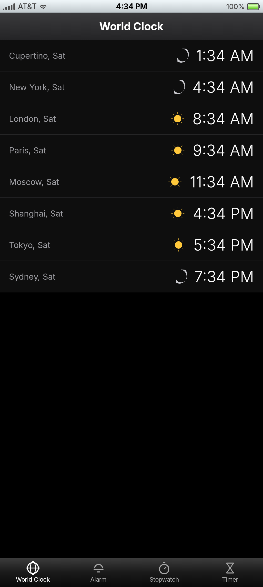 | 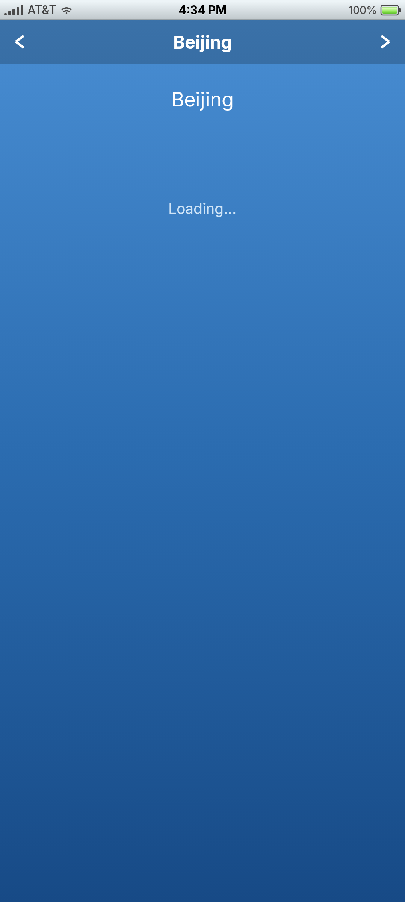 | 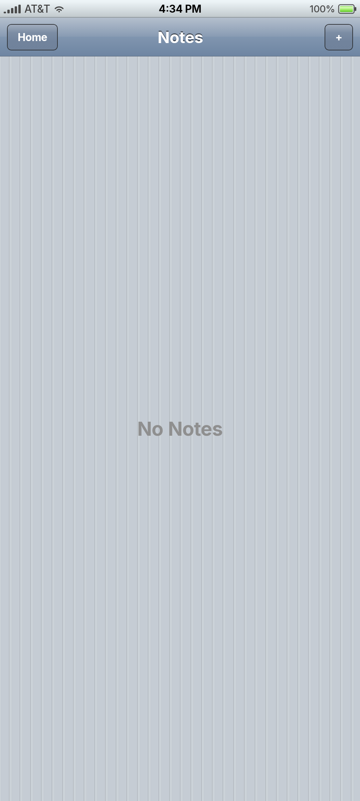 | 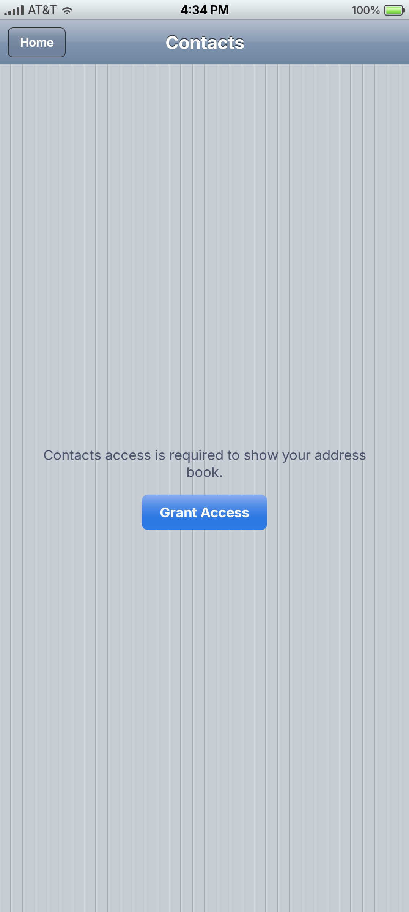 |

| Stocks | Mail | Voice Memos | Compass |
| :---: | :---: | :---: | :---: |
|  | 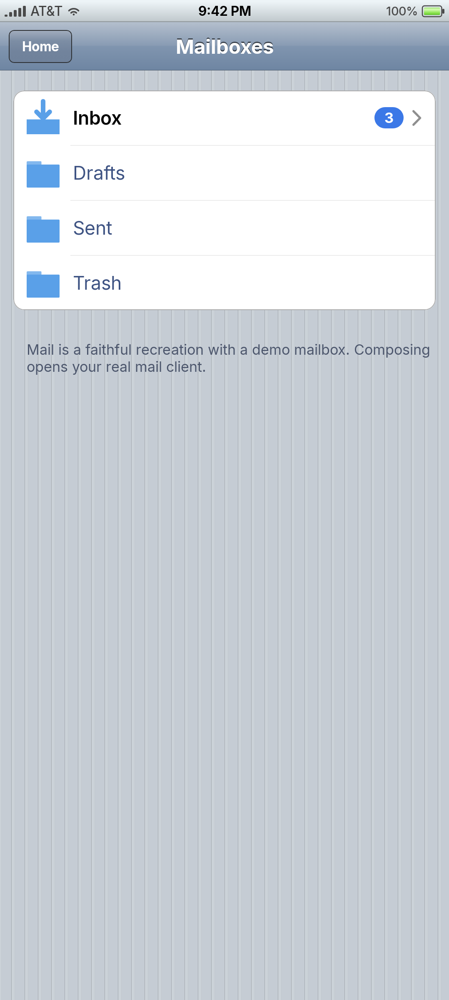 | 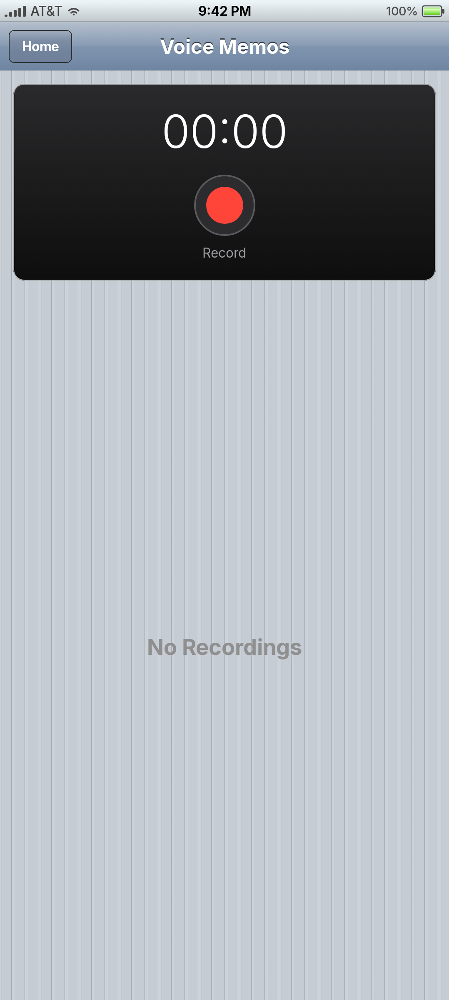 | 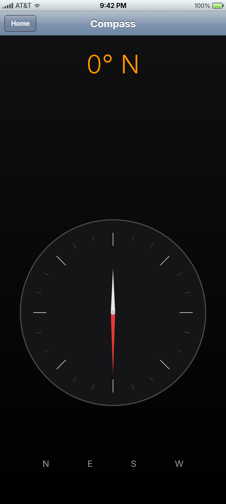 |

---

## 🛠️ Architecture & Tech Stack

- **Language**: Kotlin 2.1
- **UI Toolkit**: Jetpack Compose, 100% declarative
- **Design system**: central tokens in `ui/theme/IOS4Palette.kt` (every gradient annotated with its source), full type scale in `Type.kt`
- **Screen adaptation**: `IOS4DesignCanvas` maps the 320 pt design width onto the device, handles cutouts and gesture-nav exclusion
- **Typography**: Inter (OFL) with platform CJK fallback
- **Persistence**: DataStore (auto-observed via `snapshotFlow`)
- **System data**: `CallLog`, `SMS`, `Contacts`, `MediaStore` (images + audio) via ContentResolver
- **Visual regression**: Roborazzi screenshot suite (`gradlew recordRoborazziDebug`) — every screen is captured headlessly, no device needed

---

## 🚀 Getting Started

### Prerequisites
- Android Studio (recent) + JDK 17
- Device or emulator on **Android 8.0 (API 26)+**

### Building from Source

```bash
git clone https://github.com/zd200572/OldOS-Android.git
cd OldOS-Android
./gradlew assembleDebug
adb install -r -g app/build/outputs/apk/debug/app-debug.apk
adb shell am start -n com.oldos.android/.MainActivity
```

To regenerate the headless screenshots:

```bash
./gradlew recordRoborazziDebug   # PNGs land in app/build/roborazzi/
```

---

## 🔒 Permissions

| Permission | Purpose |
|---|---|
| `CALL_PHONE` | Making cellular calls from the dialer |
| `READ_CALL_LOG` | Recent calls in the Phone app |
| `READ_SMS` | SMS conversations in Messages |
| `READ_CONTACTS` | Contacts app / Favorites |
| `READ_MEDIA_IMAGES` (+ partial `READ_MEDIA_VISUAL_USER_SELECTED`) | Camera roll (Android 13+; legacy `READ_EXTERNAL_STORAGE` below) |
| `READ_MEDIA_AUDIO` | Music library for iPod |
| `READ_MEDIA_VIDEO` | Movie library for Videos |
| `INTERNET` | Weather (Open-Meteo) and Safari |

> [!NOTE]
> On Xiaomi / MIUI / HyperOS devices, allow **"Read SMS"** and related permissions under *Settings → Apps → OldOS → Permissions* for full functionality.

---

## 📜 Credits & Licensing

- **Code**: MIT — see [LICENSE](LICENSE).
- **Image assets** (app icons, wallpapers, dock, tray linen, media glyphs): from [**The OldOS Project**](https://github.com/zzanehip/The-OldOS-Project) by Zane Kleinberg (`@zzanehip`), used under **CC BY 4.0**. Original artwork © Apple Inc. — included here for educational, historical and preservation purposes only.
- **Font**: [**Inter**](https://rsms.me/inter/) 4.1 by Rasmus Andersson, licensed under the [SIL Open Font License 1.1](licenses/Inter-OFL.txt) (`res/font/`). Inter stands in for Helvetica Neue, which cannot be redistributed; CJK text falls back to the platform fonts.
- **Design metrics**: color stops and dimensions were cross-checked against the [nOS4](https://github.com/1etu/nos4) recreation (its UIKit metrics files); only values are referenced, no code.
- iPhone, iOS and the app designs recreated here are trademarks of Apple Inc. This is an independent tribute, not affiliated with or endorsed by Apple.

---

## 📄 License

This project is open-source under the [MIT License](LICENSE).
