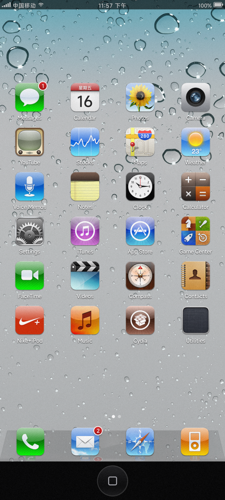
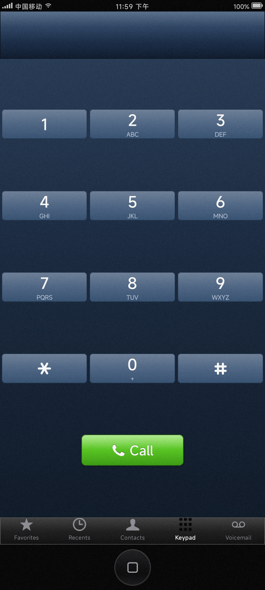
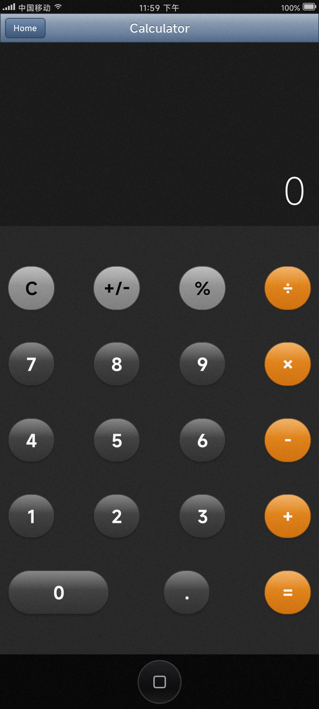

# OldOS for Android (iOS 4 Simulator)

<p align="center">
  
  
  
</p>

<p align="center">
  <b>A pixel-perfect, nostalgic recreation of iOS 4 on modern Android, built with Jetpack Compose.</b><br/>
  Featuring authentic skeuomorphic textures, working Phone with real call history, Messages with real SMS conversations, and a physical-style virtual Home Button.
</p>

<p align="center">
  <a href="#features">Features</a> •
  <a href="#screenshots">Screenshots</a> •
  <a href="#architecture">Architecture</a> •
  <a href="#getting-started">Getting Started</a> •
  <a href="#permissions">Permissions</a> •
  <a href="#credits">Credits</a>
</p>

---

## 📸 Screenshots

| SpringBoard (Home Screen) | Phone (Metallic Keypad) | Calculator (Classic LCD) |
| :---: | :---: | :---: |
|  |  |  |

---

## 📱 Highlights

Remember iOS 4 in 2010? The rich glass dock with 3D reflection, linen wallpapers, bevelled gloss buttons, green SMS bubbles, and the iconic metallic dialer keypad? 

**OldOS Android** brings that golden era of skeuomorphic UI back to life on your Android phone, engineered entirely from scratch using modern **Kotlin** and **Jetpack Compose**. It isn't just a static theme—it connects to your real Android system data so you can actually use it!

---

## ✨ Features

### 1. SpringBoard & Desktop
- **4×6 Authentic Grid**: 24 app icons per page with authentic iOS 4 typography, icon drop shadows, and circular notification badges.
- **Dynamic Calendar Icon**: Automatically updates and displays today's weekday name and date, exactly like the original.
- **Classic 3D Glass Dock**: Includes the translucent glass shelf and authentic 3D icon reflections.
- **Jiggle Mode**: Long-press icons to enter edit mode with authentic wiggling animations.
- **Multitasking Bar**: Double-tap the virtual Home button to slide the OS upward and reveal recent apps in a classic linen tray.

### 2. Virtual Hardware Home Button
- **Persistent Bottom Hardware Key**: Mimics the physical iPhone 4 recessed circular home button with the rounded square glyph.
- **Tactile Haptic Feedback**: Delivers crisp haptic pulses on press and release.
- **Gesture Controls**:
  - **Single click**: Returns to Home Screen from any app, or exits edit/jiggle mode.
  - **Double click**: Slides up the Multitasking tray.

### 3. Phone App (真实电话与通话记录)
- **Authentic Metallic Dialer**: Dark blue metallic gradient LCD display and skeuomorphic dialer buttons with authentic DTMF touch tones and vibration.
- **Real Phone Calls**: Dial any number to launch a real cellular phone call.
- **Real Call Log (Recents)**: Reads your actual phone call history from `CallLog.Calls` with missed calls highlighted in red and formatted timestamps.
- **Real Contacts**: Synchronizes with your Android contacts via `ContactsContract`, with one-tap dialing.
- **5-Tab Gloss Bar**: Favorites, Recents, Contacts, Keypad, and Voicemail.

### 4. Messages App (真实短信会话)
- **Real SMS Conversations**: Reads conversation threads directly from Android's SMS content provider (`content://sms`).
- **Authentic SMS Chat Bubbles**:
  - Sent messages: Classic iOS 4 vibrant green gradient with curved glass gloss and bottom-right tail.
  - Received messages: Matte silver/white bubble with bottom-left tail.
- **Retro Navigation & Search**: Glossy search bar, unread blue dots, and threaded date headers.

### 5. Calculator App
- **Retro LCD Display**: Classic seven-segment styled display numbers with copy-ready display.
- **Authentic Keypad**: Dark grey numeric keys with orange operator buttons and metallic pressed states.
- **Full Calculation Engine**: Real-time evaluation, chained operations, percentages, and decimals.

---

## 🛠️ Architecture & Tech Stack

- **Language**: Kotlin 2.0
- **UI Toolkit**: Jetpack Compose (100% declarative UI, zero legacy XML views)
- **Design System**: Fully custom iOS 4 Design System implemented via Compose Brushes, generic path bubble shapes, and custom layout modifiers.
- **Concurrency**: Kotlin Coroutines & Flow for asynchronous ContentProvider reading.
- **Audio & Haptics**: Android `ToneGenerator` for DTMF frequencies and `Vibrator` / `VibrationEffect` for tactile hardware button clicks.
- **System Integration**: ContentResolver interfaces to `CallLog.Calls`, `ContactsContract.CommonDataKinds.Phone`, and `content://sms`.

---

## 🚀 Getting Started

### Prerequisites
- Android Studio Hedgehog (2023.1.1) or newer
- JDK 17
- Android device or emulator running **Android 8.0 (API 26)** to **Android 14+ (API 34)**

### Building from Source

1. Clone the repository:
   ```bash
   git clone https://github.com/zd200572/OldOS-Android.git
   cd OldOS-Android
   ```

2. Build the debug APK:
   ```bash
   ./gradlew assembleDebug
   ```

3. Install on your connected device (with runtime permissions pre-granted for development):
   ```bash
   adb install -r -g app/build/outputs/apk/debug/app-debug.apk
   ```

4. Launch the app:
   ```bash
   adb shell am start -n com.oldos.android/.MainActivity
   ```

---

## 🔒 Permissions

To provide authentic functionality, OldOS requests the following Android runtime permissions:

| Permission | Purpose |
|---|---|
| `CALL_PHONE` | Allows making cellular calls directly from the dialer keypad |
| `READ_CALL_LOG` | Displays your actual recent call history in the Recents tab |
| `READ_SMS` | Loads your actual SMS conversations in the Messages app |
| `READ_CONTACTS` | Populates the Contacts and Favorites tabs with your phonebook |

> [!NOTE]
> On Xiaomi / MIUI / HyperOS devices, make sure to allow **"Read SMS"** and **"Service/Notification SMS"** under *Settings → Apps → OldOS → Permissions* to enable full SMS history viewing.

---

## 📜 Credits

- Inspired by the open-source iOS project **[OldOS](https://github.com/zzanehip/OldOS)** by Zane Kleinberg (`@zzanehip`).
- Original iOS 4 UI elements and concept © Apple Inc. This project is created for educational, historical, and preservation purposes.

---

## 📄 License

This project is open-source under the [MIT License](LICENSE).
